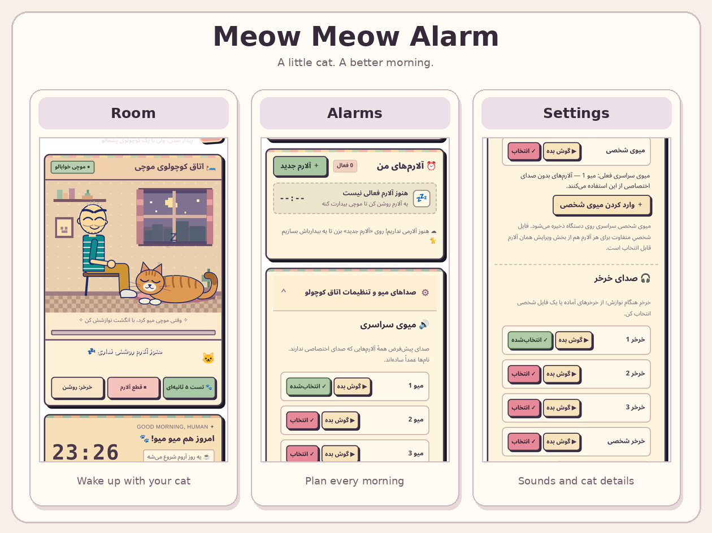
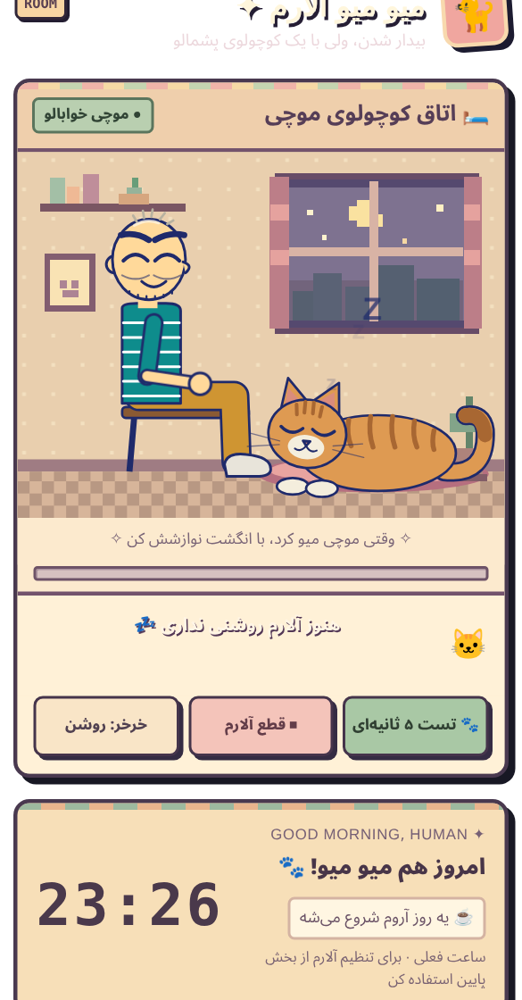
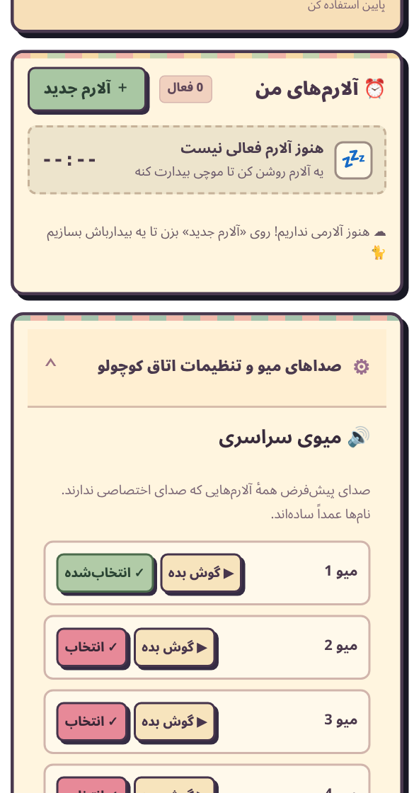
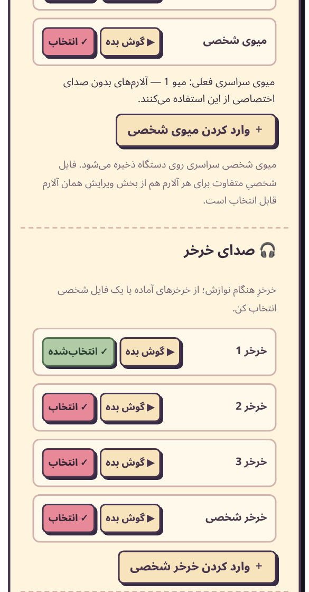

# 🐱 Meow Meow Alarm

A cozy, interactive alarm clock for Android

[فارسی](./Readme-Fa.md) · [Home](./README.md) · [Download releases](https://github.com/Arto0n/Meow-Meow-Alarm/releases)

## Meet Meow Meow Alarm

**Meow Meow Alarm** turns your morning alarm into a small interaction with a cat. When it rings, the app can open a cozy 2D room. Pet your cat, hear the meows and purrs, and start the day on a gentler note.

## The room

An interactive alarm screen with a cat you can pet. You can adjust petting duration, snooze time and the timing of the room's little animations.

## Your alarms

Create multiple alarms with their own time, label and repeat days. Turn them on or off, edit or delete them, and see which alarm is coming next.

## Sounds and your cat

Choose from **six meows** and **three purr sounds**, or import your own audio. Set a default meow for all alarms, then override it for any alarm that needs a different sound.

Give your cat a name and pick one of five coats: gray tabby, orange, black, white or calico. Cat-related text adjusts to the name you choose.

## Install

Download an APK from **[Releases](https://github.com/Arto0n/Meow-Meow-Alarm/releases)** and install it on Android 8 or newer. On first launch, follow the in-app guidance for notification, exact alarm and lock-screen permissions. Some phones may also require a battery restriction adjustment.

> Builds marked **Preview** are intended for testing and may require reinstalling when moving between builds.

## Build from source

The Android app uses **Kotlin** with an interactive **HTML / CSS / JavaScript** interface. You can build an APK using the repository's **Actions** workflow. Local development requires **JDK 17**, **Android SDK 34** and **Gradle 8.9**.
